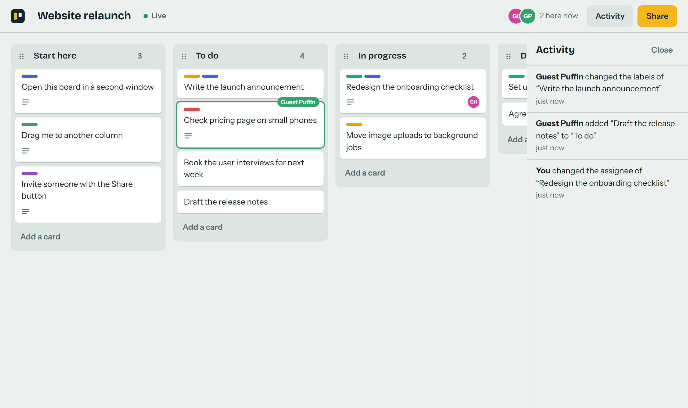
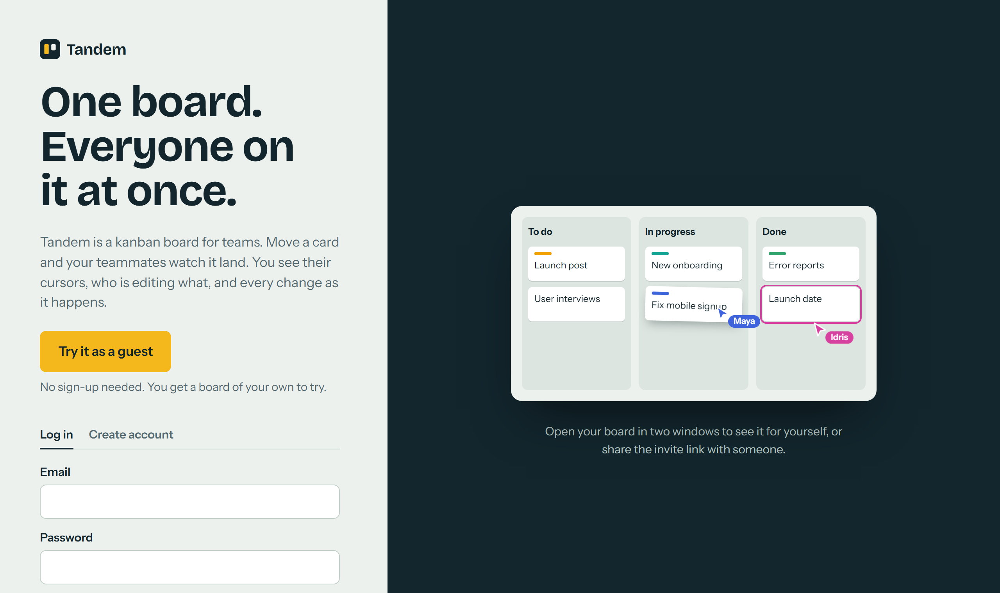
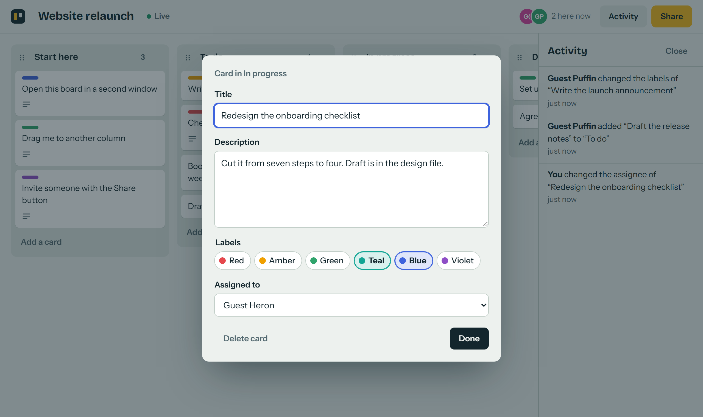
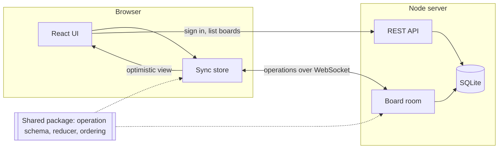

# Tandem

[](https://github.com/JosephWymanCode/tandem/actions/workflows/ci.yml)

A kanban board that several people can edit at the same time. Move a card and everyone else on the board sees it land, along with your cursor and which card you have open.



## Try it

**Live demo: https://tandem-ykdf.onrender.com**

Choose **Try it as a guest**, then use **Share** to copy the invite link and open it in a private window to appear as a second person. The demo runs on free hosting, so the first load can take up to a minute while it wakes, and its data is reset whenever the server restarts.

Or run it locally (Node 22.13 or newer):

```bash
npm install
npm run dev
```

Open http://localhost:5173, choose **Try it as a guest**, then open the same address in a second window. Use a private window, or the **Share** link, to appear as a second person.

## What it does

- **Live collaboration.** Changes reach every open browser immediately. You see other people's cursors, who is on the board, and a coloured outline on any card someone else has open or is dragging.
- **Drag and drop** for cards and columns, with mouse, touch or keyboard.
- **Works through a dropped connection.** Your changes apply on your own screen straight away. If the connection drops you can keep working; the changes are sent when it returns, and anything the server refuses is rolled back with a message.
- **Accounts and guests.** Email and password accounts, or one click to start as a guest. Boards are shared by invite link.
- **Activity feed** listing who changed what.

| Start page | Editing a card |
| --- | --- |
|  |  |

## How it works



The repository is an npm workspace with three packages:

| Package | What it holds |
| --- | --- |
| `packages/shared` | The operation schema (Zod), the reducer that applies an operation to a board, position keys, and the client sync state. Imported by both sides, so they cannot disagree about what an operation means. |
| `packages/server` | Fastify REST API, WebSocket rooms (`ws`), SQLite storage through Node's built-in `node:sqlite`. |
| `packages/client` | React, Zustand, dnd-kit, built with Vite. |

In production the server also serves the built frontend, so the whole app is one process on one port.

### Design decisions

**The server orders everything.** A client never sends "here is the new board". It sends a small operation such as `card.move`. The board's room on the server validates it, applies it, saves it, gives it the next sequence number and broadcasts it to everyone, including the sender. Because every client applies the same operations in the same order with the same reducer, they all arrive at the same board. See [`rooms.ts`](packages/server/src/rooms.ts).

**Optimistic updates with rollback.** The client keeps three things: the board as the server last confirmed it, a queue of its own unconfirmed operations, and the view (confirmed plus queue). Whenever a server message arrives, the view is rebuilt from the other two. A rejected operation is removed from the queue and so vanishes from the view; nothing has to be "undone" by hand. See [`sync.ts`](packages/shared/src/sync.ts).

**Ordering without renumbering.** Each card and column has a position key, a string that sorts between its neighbours (fractional indexing). Moving a card rewrites only that card, so two people reordering different cards at once never touch the same data. If two cards do end up with the same key, the tie is broken by id, so every client still shows the same order. See [`fractional.ts`](packages/shared/src/fractional.ts).

**Edits merge per field.** A card update carries only the fields that changed. One person retitling a card while another edits its description keeps both edits. Two people changing the same field at the same moment resolve as last writer wins.

**Reconnecting is cheap and safe.** A returning client says which sequence number it last saw. If it missed only a little, the server replays those operations from its log; otherwise it sends a fresh snapshot. The client then resends anything unacknowledged. Operations are safe to repeat: adding a card that exists is refused, and a repeated move or edit lands on the same value.

**Presence is not stored.** Cursors and "who is editing" are relayed between connections, throttled on the client, and never written to the database.

**Security basics.** Passwords are hashed with scrypt and a per-user salt. Sessions are random tokens in an `HttpOnly`, `SameSite=Lax` cookie, stored in the database only as a SHA-256 hash. The WebSocket upgrade checks the `Origin` header (browsers send cookies on cross-site WebSocket requests), the session and board membership. Every incoming message is validated against a schema, and connections that flood the server are closed. Sign-in endpoints are rate limited.

## Tests

```bash
npm test         # unit and integration tests (Vitest)
npm run e2e      # browser tests (Playwright); first run: npx playwright install chromium
npm run lint
npm run typecheck
```

- **Unit tests** cover the reducer, position keys, and the sync state, including a test that interleaves two clients' operations in different orders and checks both end up identical to the server.
- **Integration tests** start the real server on a free port with an in-memory database and drive it with real WebSocket clients: simultaneous edits, rejected operations, reconnecting, persistence, access control.
- **Browser tests** run two separate browser profiles against the production build: one drags a card and the other watches it move, and one makes a change while disconnected and it arrives after reconnecting.

GitHub Actions runs all of the above on every push.

## Deploying

The included [`render.yaml`](render.yaml) deploys the app to [Render](https://render.com)'s free tier as a single web service: create a new Blueprint in Render and point it at this repository.

Two limits of free hosting to know about:

- The service sleeps when idle, so the first visit after a quiet spell takes about half a minute.
- The disk is not kept between restarts. The hosted demo therefore starts fresh after each restart: accounts and boards created there are temporary. Running locally keeps data in `data/tandem.db`.

Configuration is by environment variable: `PORT` (default 3000), `DATABASE_PATH` (default `data/tandem.db`), `NODE_ENV=production` for secure cookies and request logs.

## Possible next steps

- Swap SQLite for Postgres so hosted data survives restarts. All database access is in [`repo.ts`](packages/server/src/repo.ts).
- Character-level merging for descriptions, so two people can type in the same description at once.
- Run more than one server process, with a shared message bus between rooms.

## Licence

MIT
